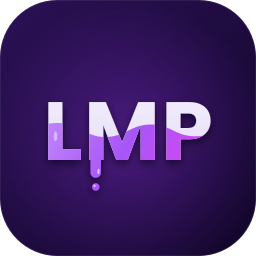

  

<h1 align="center">LMP — Leo's Material Painter</h1>

Owned by <a href="https://github.com/LeoDevRX">LeoDevRX</a>

LMP is a free program for painting textures on 3D models. Open a model, paint on it with layers, masks and smart materials, then export the textures for Roblox, Unreal, Unity or Blender.

It's a free alternative to paid material painting programs, for anyone who would rather not pay for a subscription or deal with licence restrictions. The controls are kept familiar, so if you've used Substance Painter, most things work the same way.

I built LMP with help from Claude Opus 5.5, an AI model by Anthropic, to make my creative workflow easier.

**What it can do**
- Paint colour, roughness, metal, height and glow in one stroke, with brushes, layers, folders and masks
- Smart materials and smart masks (edge wear, dirt, rust) that follow your model's shape
- 114 free scanned materials, plus Substance .sbsar materials with all their settings
- Bake normal, AO, curvature and other mesh maps, including from a high poly model
- A built-in Guide that walks you through each tool

## Download

**[Download the latest version](https://github.com/LeoDevRX/LMP/releases/latest)** (Windows 10/11, 64-bit)

- **New install:** download `LMP-vX.XX.zip`, extract it anywhere (for example `D:\LMP`) and open `LMP.exe`. Nothing needs installing.
- **Already have LMP:** click **Update** in LMP when it tells you there's a new version. You can also download the small `LMP-vX.XX-update.zip`, extract it into the folder that holds your LMP folder and replace files when Windows asks.
